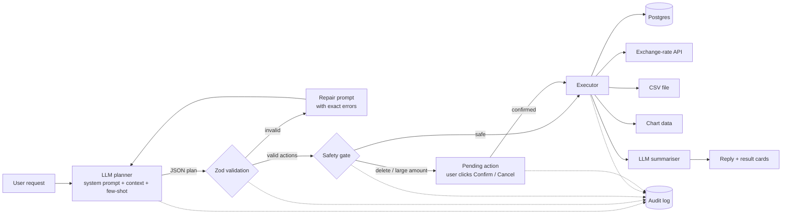

# Spendwise — an AI expense agent

Spendwise turns plain-English requests like *"paid 40 for gas yesterday and 15.99 for Spotify, then show me this month as a pie chart"* into real, validated actions: database writes, queries, an external currency-API call, CSV file generation and charts. Destructive actions always ask first, and every step is written to an audit log.

**Live demo:** _add your Vercel URL here_ · **Video:** _add your YouTube link here_

## The problem

Most people stop tracking expenses because logging is tedious: open an app, pick a category, type the amount, pick a date. Asking a question ("how much did I spend on food this month?") means filters and spreadsheets. Spendwise removes that friction for students and anyone on a tight budget: you just say what happened or what you want to know, and the agent does the work, safely.

## What it can do

| You say | The agent does |
|---|---|
| "spent 12.50 on lunch at chipotle" | Inserts an expense (Food, today) |
| "bought a €25 museum ticket" | Calls the Frankfurter exchange-rate API, stores EUR + USD value |
| "how much did I spend on food this month?" | Runs a grouped SQL summary |
| "show my spending by category as a pie chart" | Builds chart data, rendered in the UI |
| "set a $150 food budget and check my budgets" | Upserts a budget, then reports progress bars |
| "change #12 to $18" | Updates the record |
| "delete all my Starbucks purchases" | Finds the rows, shows them, **waits for Confirm** |
| "export this month to CSV" | Generates a downloadable CSV file |
| "convert 100 USD to GBP" | Live currency conversion |
| "I bought groceries" | Asks a clarifying question (amount missing) |

## How it meets the assignment requirements

| Requirement | Where |
|---|---|
| **LLM integration**: connect, send prompts, handle API errors and rate limits | `lib/llm.ts`: OpenAI client, JSON mode, exponential backoff with jitter, honours `Retry-After`, timeouts, friendly messages for 401 / quota / 404 / 5xx. `lib/http.ts`: per-user rate limit on our own API |
| **Action interpreter / executor**: parse output, convert to operations, multiple domains | `lib/actions.ts`: 10 action types, each a Zod schema. `lib/executor.ts`: database (insert/select/update/delete/upsert), external API (exchange rates), file generation (CSV), data visualisation |
| **User interface**: natural language input, results, status, feedback | `app/page.tsx` + `components/`: chat, per-action status cards (Done / Failed / Blocked / Needs your OK), expandable "how the agent planned this", raw action JSON, tables, charts, download buttons, ledger / month / audit tabs |
| **Error handling & safety**: validate before execution, graceful errors, confirmation, audit log | Schema validation + self-repair loop, action allow-list, no LLM-written SQL, confirmation for deletes and amounts ≥ $1,000, atomic one-time confirmation tokens with 15-min expiry, per-browser data isolation, CSV formula-injection guard, full audit log (`audit_log` table, visible in the UI) |

## Architecture



The LLM never touches the database directly. It can only *propose* actions from a fixed catalog; the program validates them, decides whether a human must approve, executes them with parameterised SQL, and reports back.

## Prompt engineering techniques

All prompts are in [`lib/prompts.ts`](lib/prompts.ts).

1. **Role and goal framing.** The model is told it is a planner that outputs actions, not a chatbot that talks through the task.
2. **Structured output contract.** Exact JSON shapes for all 10 actions plus a fixed top-level format, enforced with OpenAI JSON mode and validated with Zod.
3. **Dynamic context injection.** Each request includes today's date, weekday and timezone (so "last Friday" resolves correctly), the user's 15 most recent expenses *with ids* (so "delete the Chipotle one" works), and current budgets.
4. **Explicit rules.** Relative-date resolution, category mapping hints, default currency, "never invent ids", "never state numbers yourself", "ask one question if something essential is missing".
5. **Few-shot examples.** Six examples: a simple add, a multi-action request, a foreign-currency expense (log the original currency; the program converts), an ambiguous request (clarification), a delete by filter, and a prompt-injection attempt that must produce no actions.
6. **Plan-before-act reasoning.** A short `reasoning` field makes the model state its interpretation before choosing actions (lightweight chain-of-thought); it is shown in the UI for transparency.
7. **Prompt-injection defence.** User data (expense notes, merchants) sits inside tagged blocks and the prompt states it is data, never instructions. Even if the model is fooled, it can only choose allow-listed actions.
8. **Self-repair loop.** If the output is not valid JSON or fails validation, the exact errors are sent back ("actions[0] (add_expense): amount must be positive") and the model corrects itself, up to 2 times.
9. **Prompt chaining.** A second, separate prompt turns raw execution results into the short answer the user reads, with instructions to use only numbers from the results (prevents hallucinated totals).
10. **Conversation memory.** Recent turns, including action outcomes like "Added #23", are sent along so follow-ups ("actually make that $15") work.

## Run locally

```bash
npm install
cp .env.example .env.local      # then put your OpenAI key in it
npm run dev                     # http://localhost:3000
```

No database setup is needed locally: without `DATABASE_URL` the app uses PGlite, a real Postgres engine embedded in Node, stored in `./.pglite`.

## Deploy (Vercel + Neon, both free)

1. Push this repo to GitHub.
2. On [vercel.com](https://vercel.com) → **Add New → Project** → import the repo.
3. In the project, open **Storage → Create Database → Neon (Postgres)** and connect it. Vercel adds `DATABASE_URL` automatically. (Or create a free database at [neon.tech](https://neon.tech) and paste its connection string as `DATABASE_URL`.)
4. Under **Settings → Environment Variables** add `OPENAI_API_KEY` (and optionally `OPENAI_MODEL`, `APP_TIMEZONE`).
5. Redeploy. Tables are created automatically on the first request.

Each browser gets an anonymous id, so graders testing the URL each see only their own data. Use **Load sample** in the sidebar for instant demo data.

## Tests

```bash
npm test
```

18 end-to-end tests run the full pipeline (planner → validation → safety gate → executor → audit) against an in-memory Postgres, using a scripted fake LLM and a mocked exchange-rate API. They cover multi-action plans, foreign currency, self-repair, rejected unsafe actions, clarification, confirm/cancel/replay of deletes, large-amount confirmation, cross-user isolation, CSV formula injection, external API failure, and SQL-injection-style input.

## Project structure

```
app/
  page.tsx              chat UI
  api/agent/            main agent endpoint
  api/confirm/          confirm / cancel pending actions
  api/expenses|audit/   sidebar data
  api/seed|reset/       demo helpers
components/             ResultCard, Sidebar, Chart
lib/
  llm.ts                LLM integration (retries, errors, JSON parsing)
  prompts.ts            all prompts
  actions.ts            action catalog + validation + safety policy
  agent.ts              orchestrator (plan → repair → gate → execute → summarise)
  executor.ts           DB, API, file and chart operations
  audit.ts, db.ts       audit log and database layer
scripts/test-agent.ts   end-to-end tests
```

## Tech

Next.js 15 (App Router) · TypeScript · OpenAI API · Zod · Postgres (Neon / PGlite) · Tailwind CSS · Recharts · Frankfurter exchange-rate API
